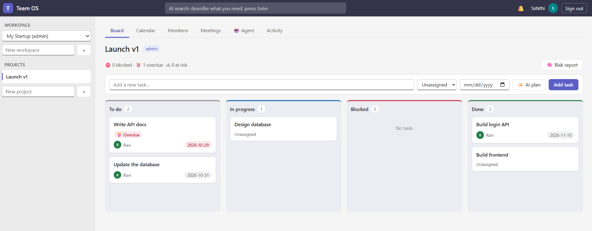
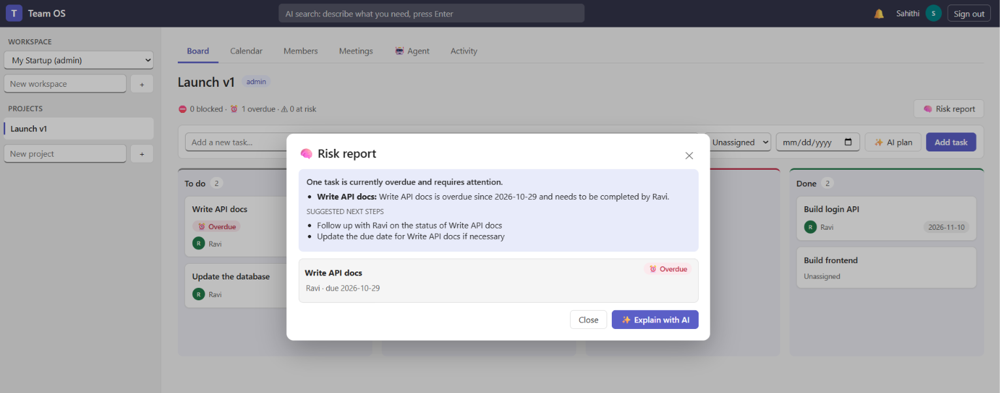
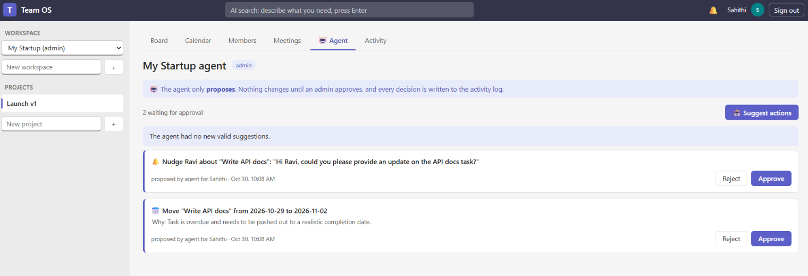
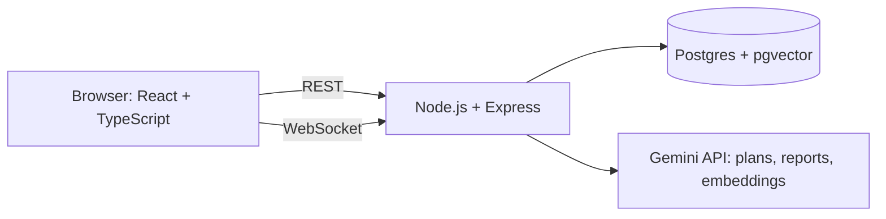

# Team OS: an AI operating system for teams

A multi-tenant work platform (think Jira or Lark) where AI understands the work. It turns messy briefs into task plans, detects delivery risks across a dependency graph, extracts action items from meetings, and proposes fixes that only happen after a human approves.

## Screenshots

### Board with live risk badges


### AI risk report


### Approval-gated agent


## Features
- **Work management:** workspaces, projects, kanban board with drag and drop, task panel with comments, shared calendar, meetings, member roles (admin, member, viewer).
- **Realtime:** WebSockets keep every screen in sync, with live notifications.
- **AI plan:** paste a brief, review the draft tasks and dependencies, then approve.
- **Risk engine:** a dependency graph flags tasks that are blocked, overdue, or at risk because something upstream slipped, and alerts the owners instantly. An AI report explains what is slipping and why.
- **Meeting agent:** notes become a summary, decisions, and tasks, with owners matched to team members.
- **Semantic search:** find tasks and meetings by meaning, not keywords.
- **Approval-gated agent:** the AI proposes actions (reschedule, reassign, nudge). Admins approve or reject, and every decision is written to an audit log.

## Architecture


## Design decisions
- **Code decides, AI explains.** Risks come from deterministic graph code. The model only writes the words, and its output is validated before use.
- **The model proposes, code validates, a human approves.** AI actions go through schema validation, tenant checks, and an approval step with stale-state detection and row locking.
- **Tenant isolation.** Every row carries `workspace_id`, every route checks membership and role, and vector search is workspace-scoped.
- **Cycle-proof dependencies.** Cycles are rejected on write with a recursive query, and AI plans may only depend on earlier tasks.
- **Cost-aware AI.** Provider-agnostic LLM layer with model fallback, per-user rate limits, query caching, lazy re-indexing, and no AI call when there is nothing to analyze.

## Security
bcrypt password hashing, signed JWTs, role-based access control, parameterized SQL only, zod validation on all input, WebSocket authentication with membership checks, and a full audit log.

## Tech stack
React, TypeScript, Vite · Node.js, Express, ws · PostgreSQL, pgvector (HNSW, cosine) · Gemini API (free tier)

## Run locally
Requirements: Node 20+, Docker, and a free Gemini API key from https://aistudio.google.com/apikey

```bash
# 1. database
docker run -d --name teamos-db -e POSTGRES_PASSWORD=pass -e POSTGRES_DB=teamos -p 55432:5432 pgvector/pgvector:pg16

# 2. create tables (from the server folder, in this order):
#    schema.sql, migrations/001_notifications.sql, 002_events.sql,
#    003_search_meetings.sql, 004_agent.sql
#    PowerShell example:
#    foreach ($f in "schema.sql","migrations\001_notifications.sql","migrations\002_events.sql","migrations\003_search_meetings.sql","migrations\004_agent.sql") { Get-Content $f | docker exec -i teamos-db psql -U postgres -d teamos }

# 3. API
cd server
cp .env.example .env     # then fill in JWT_SECRET and GEMINI_API_KEY
npm install
npm run dev              # http://localhost:4000

# 4. website (new terminal)
cd client
npm install
npm run dev              # http://localhost:5173
```

## Known limitations and next steps
- Realtime rooms live in server memory, so scaling out would need Redis pub/sub.
- The WebSocket token travels in the URL; a short-lived ticket would be safer.
- Members must sign up before they can be invited (no email invites yet).
- Automated tests are the next addition (integration tests for the risk engine and approval flow).